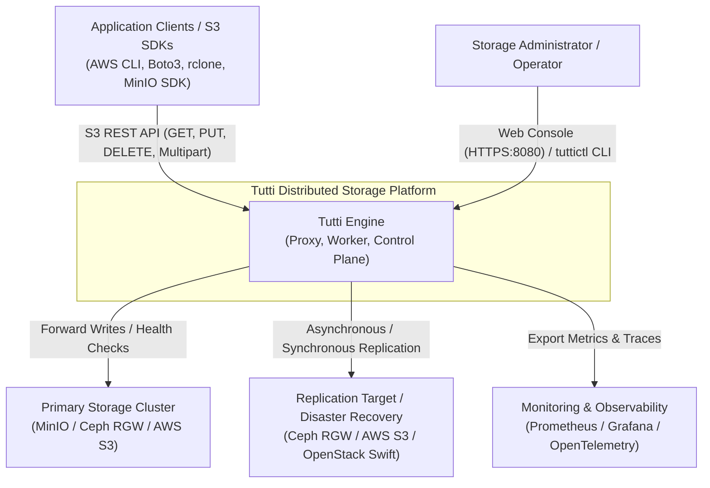
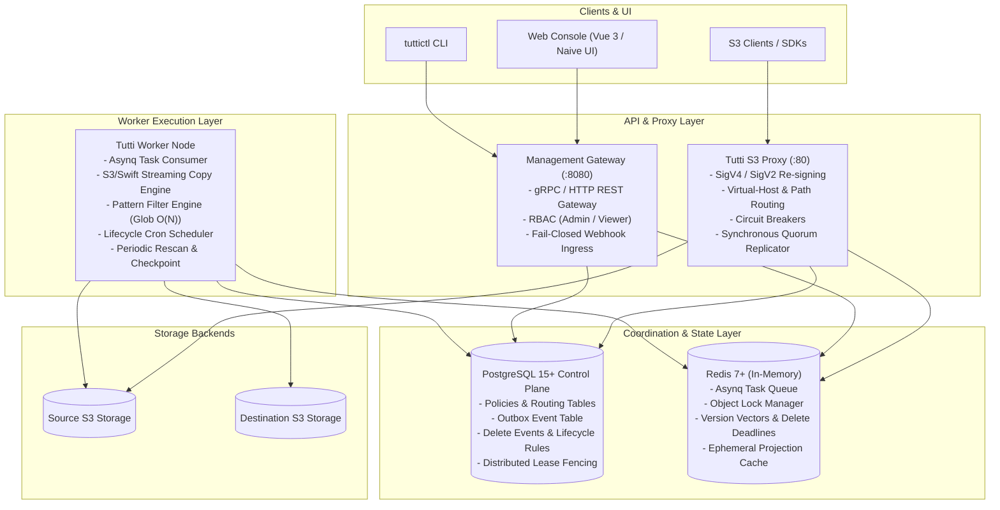
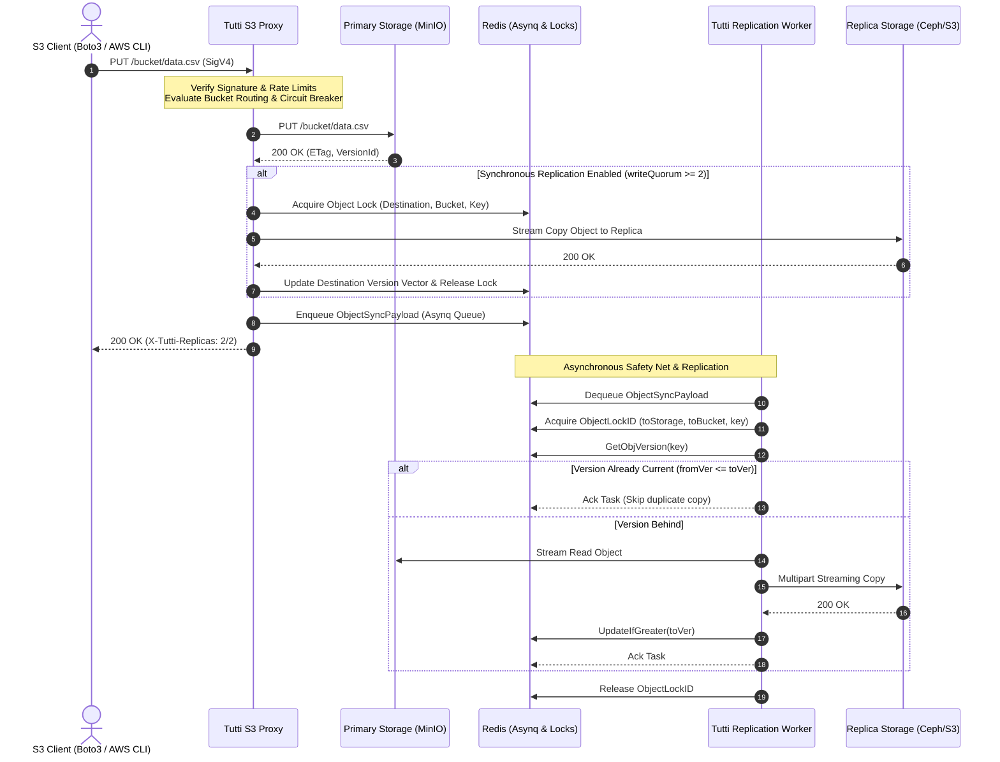
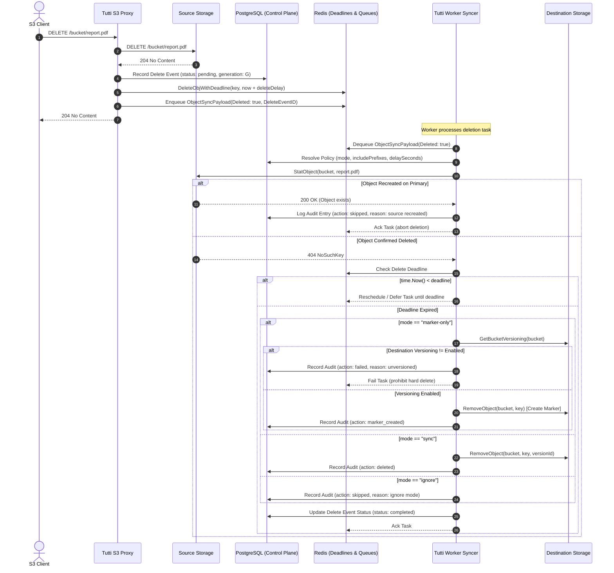
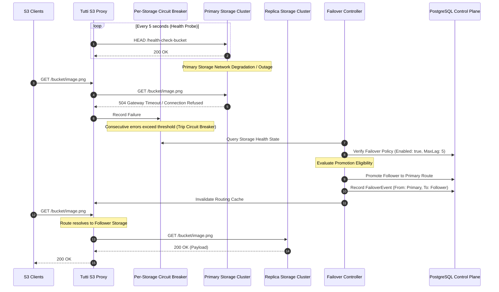
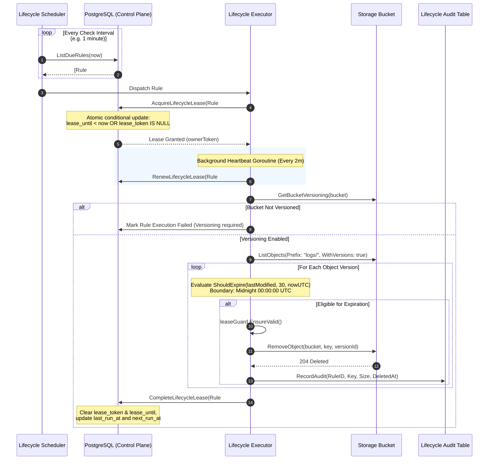

# Tutti Architecture & Sequence Flows

This document details the system architecture of **Tutti** using the C4 model and provides sequence diagrams for key operational scenarios.

---

## 1. C4 Architecture Models

### 1.1 Level 1: System Context Diagram

---

### 1.2 Level 2: Container Diagram

---

## 2. Sequence Diagrams for Core Scenarios

### 2.1 Write & Replication Flow (Synchronous & Asynchronous)

---

### 2.2 Delete Propagation & Delete Marker Sync Flow

---

### 2.3 Automatic Storage Failover Flow

---

### 2.4 Lifecycle Management Engine Flow

